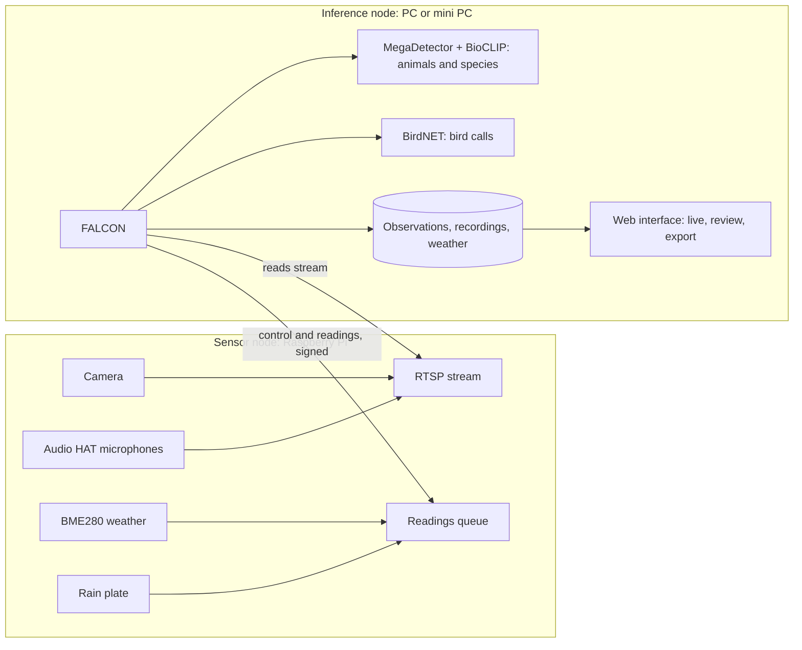

# FALCON

**Field Acoustic, Lens & Climate Observation Node** — wildlife monitoring with a camera,
microphones and weather sensors, analyzed locally.

FALCON watches a place for animals. A **sensor node** (a Raspberry Pi with a camera,
microphones, a temperature/humidity/pressure sensor and a rain plate) streams what it sees
and hears. An **inference node** (a PC, mini PC or laptop) finds animals in the video,
suggests the species, identifies bird calls, records each stay of an animal and notes the
weather at that moment. You check the results in a web page, correct them with one click,
and export a clean dataset in the Camtrap DP standard for researchers.

Everything runs on your own hardware. No video, sound or records go to a cloud service
unless you post a visit to iNaturalist yourself.



The two can sit side by side at a remote site (one Ethernet cable, no internet needed), or
apart: the node outdoors and the computer indoors on the home network.

## What it does

- **Live view** with detection boxes, and a feed of animal visits you can Confirm, Correct,
  mark Unsure or Discard as they happen.
- **Review** by time window, species, status, session and score. Each visit gets one of
  Confirm, Correct (choose the right species), Unsure or Discard, with an optional note;
  one decision covers all frames of a visit, bulk actions cover many. Every decision is
  audited; model output is never overwritten.
- **Hidden status**: visits FALCON sets aside by itself (glimpses, still objects, small or
  uncertain detections, unidentified sounds) wait under *Hidden* in Review. Those you do not
  review within 7 days are cleared.
- **Recordings**: one continuous recording per stay of an animal, from 5 seconds before the
  first detection until 15 seconds pass with nothing detected, with the microphone sound
  merged in. A sound record covers the whole stretch in which a bird keeps calling.
  Pictures, crops and spectrograms appear on every review card.
- **Sound names**: BirdNET listens twice, to the sound as received and to a cleaned copy;
  the cleaned pass is a second opinion. Birds are named by sound only if they are on the
  regional list; other calls are kept as *Unidentified sound* for review. The two sound
  lists in this release are built for North India (the birds BirdNET listens for) and
  Rajasthan (the birds it names).
- **Retention**: recordings of visits you Confirm or Correct are kept. Recordings of
  discarded visits are removed one to two hours after the decision, all others after
  60 days; the record, its picture and its details stay. Visits FALCON hid by itself that
  you never reviewed are cleared completely after 7 days.
- **Post to iNaturalist**: a confirmed or corrected visit is posted only when you press
  Post, with your own iNaturalist account and key. You choose the pictures and the sound.
- **Status line**: one line under the top bar says when a page is loading, when FALCON is
  slow to answer, and when the connection is lost.
- **Phone layout**: every page works on a phone, with records opening full screen.
- **Sensor node control** from the web page: start/stop the stream, switch the camera,
  microphone, weather sensor and rain plate on or off, focus, exposure, white balance, HDR,
  resolution and more, node health (temperature, power, storage, Wi-Fi, clock), restart.
- **Weather** every 30 seconds, attached to each detection, kept even when the network drops.
- **Export** a time window as a Camtrap DP 1.0 package (GBIF, Agouti, Wildlife Insights,
  R `camtrapdp`), with verified-only, verified-plus-unreviewed or everything-but-discarded.
- **Unattended**: starts after a power cut, reconnects, sets the node's clock when there is
  no internet, restarts a stalled analysis.
- **Media tests**: try it on any photo, video or sound recording.
- Private remote access through Tailscale.

## What is new in FALCON 2.0

- One continuous recording per stay with the microphone sound, instead of 10-second clips.
- Review with Confirm, Correct, Unsure, Discard and notes, a Hidden status and a phone layout.
- Clearing of hidden visits after 7 days, and the retention rules above.
- Posting confirmed visits to iNaturalist on your own press, with your own key.
- Sound names limited to the regional bird list, and two-pass listening.
- One status line for loading, slow answers and a lost connection.
- Licence: AGPL version 3 with additional terms (see below).

## Quick start

### 1. Inference node (the computer that runs FALCON)

Linux x86-64 or Windows with WSL2 Ubuntu. An NVIDIA GPU is used if present.

```bash
git clone https://github.com/vinaychittora/FALCON.git
cd FALCON
make install          # Python, Node, FFmpeg and dependencies, inside this folder
make taxa             # species list for your region, see below
make start            # then open http://127.0.0.1:8000
```

`make taxa` builds the list of species FALCON chooses from, using iNaturalist research-grade
records. The default region is Rajasthan, India. For your region:
`make taxa ARGS='--place "Kerala, India"'` (any iNaturalist place name or ID); add
`--include-domestic` to label livestock and pets correctly. It then also builds the groups
used for group-level names such as "Cat (species uncertain)". Details: [docs/INSTALL.md](docs/INSTALL.md).

### 2. A sensor

You need at least one sensor. Any of these works:

| You have | Do this |
| --- | --- |
| **The FALCON Pi node** (camera, microphones, weather, rain) | Write Raspberry Pi OS Lite with Raspberry Pi Imager, then run `python3 node/sdcard/prepare_sdcard.py <bootfs drive>`. Put the card in the Pi: it installs itself and starts streaming. Or run `sudo bash node/install.sh` on the Pi. |
| A Raspberry Pi with only some of the parts | Same as above: the node finds what is attached. A weather-only or microphone-only node works too. |
| A Linux computer with a USB webcam or microphone | `sudo bash node/install.sh` on that computer: it becomes a sensor node. |
| An IP camera (RTSP), e.g. TP-Link Tapo | FALCON → **Sensors** → *IP camera*: enter its stream address and account. |

Then in FALCON open **Sensors → Add sensor node**, enter the node's address and the pairing
key printed by its installer, and press **Start observing** on **Live**.
Full guide: [docs/SENSOR_NODE.md](docs/SENSOR_NODE.md).

### 3. Build the node hardware

The [node build handbook](docs/handbooks/FALCON-Node-Build-Handbook.pdf) explains the parts,
wiring, power (USB-C or PoE), 3D-printed enclosure and assembly step by step. Printable
STL/STEP files, drawings and the parametric CAD model are in [hardware/](hardware/).

The enclosure is a design for the Raspberry Pi Camera Module 3 and has not been printed yet.
The node in use runs in a plastic junction box with a USB infrared webcam (see [Status](#status)).

## Documentation

All of these are also inside FALCON: open **Help** in the menu (with search across every guide).

| Guide | For |
| --- | --- |
| [User guide](docs/USER_GUIDE.md) | Using the web interface: Live, Review, Summary, Sensors, Export |
| [Inference node install](docs/INSTALL.md) | Installing, auto-start, updates, WSL |
| [Sensor node](docs/SENSOR_NODE.md) | Setting up and connecting the Raspberry Pi node |
| [Node build handbook (PDF)](docs/handbooks/FALCON-Node-Build-Handbook.pdf) | Building the node hardware |
| [Data export](docs/DATA_EXPORT.md) | The Camtrap DP package and how fields are mapped |
| [Operations](docs/OPERATIONS.md) | Where data is kept, backups, troubleshooting |
| [Architecture](docs/ARCHITECTURE.md) | How the parts fit together; APIs |
| [Remote access](docs/REMOTE_ACCESS.md) · [Security](SECURITY.md) | Private access and the trust model |
| [Model licenses](docs/model-licenses.md) | Licenses of the models (BirdNET is non-commercial) |

## How the identification works

MegaDetector finds animals, people and vehicles in sampled frames (3 per second by
default). A tracker follows each animal. BioCLIP 2 or BioCLIP 2.5 compares the best crops of
a track with the names on the local species list; a cross-check mode needs both models to
agree. BirdNET listens on the CPU in 3-second windows for every bird of North India
(Jammu and Kashmir, Ladakh, Himachal Pradesh, Uttarakhand, Punjab, Haryana,
Chandigarh, Delhi, Uttar Pradesh, Rajasthan, Madhya Pradesh and Gujarat), in any week of
the year; the site location, if set, only narrows the birds of the local species list that
are outside that region. FALCON names only birds on the regional list (Rajasthan in this
release). People and vehicles are not saved as animals.

The scores rank candidates; visual similarity is not a probability, and a visit is not a
count of individuals. Treat unreviewed results as suggestions. Small, distant or hidden
animals can be missed. The first analysis downloads about 2–4 GB of model weights.

## Development

```bash
make dev        # interface on http://127.0.0.1:5173 with live reload, API on :8000
make test       # backend, sensor node and interface tests
make lint       # ruff, mypy, eslint
make build      # production interface
```

Python 3.11 (FastAPI, PyTorch, PyAV) for the inference node, standard-library Python 3.11+
for the sensor node, React + TypeScript for the interface, SQLite for storage.

Changes reach `main` through pull requests only: push a branch or a fork and open one.
Direct pushes to `main` are refused.

## Status

FALCON is a working prototype. Build 1 (tag `v1.0`) was put together between 27 October and
10 November 2026 in a backyard in Kota, Rajasthan; build 2 (release 2.0) followed in November
2026. Its node has watched one water bowl there since the evening of 7 November 2026. The sensor node is a Raspberry Pi 4 with a
USB infrared webcam, the audio HAT, a BME280 and a rain plate in a plastic junction box on
one PoE cable. The inference node is a Windows PC (WSL2) with an NVIDIA GPU.

Not done yet: the 3D-printed enclosure in [hardware/](hardware/) has never been printed,
Jetson packaging is not done, the Camtrap DP export validates against the standard but
has not been loaded into anyone else's tools, the bird-sound lists are built for North
India and Rajasthan (another region needs the two list scripts changed), and a view-only
page for invited friends (System → Device access → Friends (view only)) is included but
has not been tried with real viewers; it listens only on this computer until a Cloudflare
or Tailscale front door is set up. What the builds recorded, and where they fall
short, is described on the [project page](https://mhtr.in/falcon/).

## License and credits

FALCON is developed by **Vinay Chittora**. Copyright (C) 2026 Vinay Chittora.

The application code is free software under the
[GNU Affero General Public License, version 3](LICENSE), with the
[additional terms](ADDITIONAL-TERMS.md) that section 7 of the license permits. In plain
words:

- You may use FALCON, study it, change it and share it.
- If you share FALCON or a changed version, or run a changed version that other people use
  over a network, you must offer them the source code of your version under this same
  license.
- Keep the author credit in the files and on screen, say clearly that a changed version
  is changed, and give it its own name. The license does not cover the name FALCON or
  its mark.

The code up to and including commit `f6e2995`, which contains release `v1.0`, was
published under the Apache License 2.0 and stays available under that license.

The models (MegaDetector, BioCLIP, BirdNET), MediaMTX, the Waveshare audio HAT mixer file
and iNaturalist taxonomy keep their own licenses and attribution; see
[docs/model-licenses.md](docs/model-licenses.md) and [NOTICE](NOTICE).
