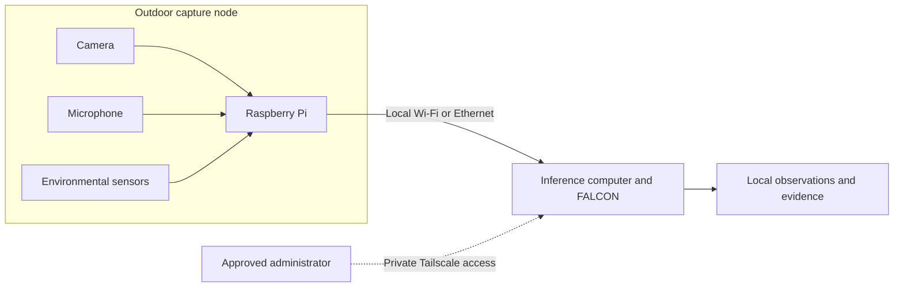

# Field deployment design

FALCON — Field Acoustic, Lens & Climate Observation Node

Developer: **Vinay Chittora**

This is the deployment design for two physical arrangements of the same system.
It is not a claim that a Raspberry Pi capture agent, sensor integration or evidence
recorder has already been field tested. The
[requirements checklist](REQUIREMENTS.md) records implementation progress; the
[appliance guide](APPLIANCE.md) describes the existing startup service.

## Two arrangements

| | Backyard or park with a nearby building | Remote, standalone installation |
| --- | --- | --- |
| At the observation point | Camera, microphone and environmental sensors connected to a Raspberry Pi capture node | The same capture node and sensors, with an inference computer nearby in a protected enclosure |
| Inference and web application | Main Linux computer indoors, with its own reliable power | Local Linux inference computer; a suitable GPU/Jetson-class target requires validation |
| Connection between node and server | Local Wi-Fi, or Ethernet when practical | Short Ethernet connection; a small switch only if needed for additional devices |
| Power | Building supply or a separately sized supply for the outdoor node | Battery, regulated DC supplies and optional solar charging power every component |
| Internet | Optional for remote administration | Optional; recording and local analysis must continue without it |
| Visiting administrator | Local network access or approved Tailscale access | Direct maintenance Ethernet or a deliberately configured local Wi-Fi network; Tailscale when an internet uplink is available |



In the standalone arrangement, the inference computer moves into the field and
the inter-device link becomes wired. The logical interfaces stay the same. The Pi
is responsible for reliable acquisition and sensor timestamps; it is not assumed
to run the large species classifier. The Pi and GPU inference computer remain
separate in every deployment. Hardware revisions and new sensor drivers preserve
this boundary. Today's Linux installer targets x86-64; ARM64/Jetson installation is
still a separate acceptance task.

A Wi-Fi network and an internet connection are different things. A powered local
router/access point can connect the Pi and server without internet. Loss of the
internet must affect remote access, not acquisition. Loss of the Pi-to-server link
is a different fault: recording may pause and the unavailable interval is a
coverage gap. The selected deployment has the camera, microphone and sensors
connected directly to the Pi. The existing CCTV stream is a development fixture,
not the intended field capture hardware.

## Current hardware and replaceable interfaces

The initial bench node is a Raspberry Pi 4 Model B with 1 GB RAM, Camera Module 3
Standard (IMX708), Waveshare DA7212 Audio HAT (B), 32 GB microSD and the official
5.1 V / 3 A supply. These are replaceable capture components, not requirements of
the inference application. No climate sensor model has been selected.

Begin bench validation at 1080p / 25 fps H.264, with a short keyframe interval and
a separately verified microphone track. Measure memory, sustained temperature
and network loss before increasing the workload. The Pi must not load BioCLIP,
BirdNET or the FALCON web server. Keep the microSD for the OS and bounded logs;
retained evidence belongs on the inference computer. Supply rating is capacity,
not measured deployment power.

One GB is a plausible starting point for this capture-only workload, not a tested
capacity guarantee. Use Raspberry Pi OS Lite without a desktop. Climate samples
are small; camera buffers, audio processing and streaming services dominate memory.
If this board is already available, measure it before replacing it; 2 GB or 4 GB
provides more margin for a new purchase. Run a sustained capture/network test and
check available memory, swap activity, dropped frames, audio gaps, temperature and
kernel out-of-memory reports. Sensor expansion also depends on bus addresses,
GPIO allocation, electrical compatibility and power, independently of RAM.
[Official headless setup guidance](https://www.raspberrypi.com/documentation/computers/getting-started.html#headless-remote-setup).

The HAT has onboard microphones and uses I²C1 address `0x1A` plus I²S. Check
pin/address conflicts before adding sensors; use the manufacturer's **Type B**
driver and mixer configuration. Select the ALSA capture device by stable name,
not an assumed card number. [Waveshare Type B documentation](https://docs.waveshare.com/DA7212-Audio-HAT-B),
[vendor source](https://github.com/waveshareteam/DA7212-Audio-HAT-B).

Acceptance requires recording and playing camera/microphone samples on the actual
Pi, then streaming both tracks to FALCON over Wi-Fi and Ethernet. Test cold boot,
link loss and recovery. These hardware tests have not been run on this development
PC. A different Pi or sensor changes node drivers and provisioning, not the RTSP,
sensor-record or evidence-review interfaces.

## Capture-node responsibilities

The intended node service starts at boot and manages camera/audio capture,
sensor polling and a health heartbeat. Each node has its own
identity and provisioned secret; it must not send sensor data to an unauthenticated
public endpoint. Restrict acquisition traffic to the intended server using the
deployment network and authenticated protocols.

Raspberry Pi's camera tools support saving or streaming camera output, and its
documentation describes media servers that can expose those streams as RTSP.
For the selected direct-camera arrangement, the practical integration is a
supported CSI camera through the Pi OS `libcamera`/`rpicam` stack, a separately
supported microphone/audio input, and a local RTSP server that muxes the video
and microphone tracks. Microphone capture and audio muxing require their own
configuration; a camera-only command does not provide microphone audio.
This establishes a feasible capture path, not a ready-made FALCON node installer.
Choose the camera, microphone and encoding settings together and measure sustained
CPU use, temperature, bitrate and audio continuity. Raspberry Pi 5 uses software
H.264 encoding rather than a dedicated H.264 encoder, so encoding must be included
in the node's workload budget. [Camera software documentation](https://www.raspberrypi.com/documentation/computers/camera_software.html),
[Raspberry Pi H.264 encoding white paper](https://pip-assets.raspberrypi.com/categories/685-app-notes-guides-whitepapers/documents/RP-010033-WP-1-H.264%20encoding%20performance%20on%20Raspberry%20Pi%205_series%20computers.pdf).

The selected policy has no continuous recording archive and no Pi backlog upload.
Only a short rolling buffer supports encounter evidence. When the node-to-server
link fails, observation and recording may pause; recovery resumes from the live
stream and cannot reconstruct the missing interval. Health reporting must make
that gap visible, alongside camera/audio status and reconnect counters. A gap is
not evidence that no animals were present. Sensor measurements unavailable during
the interruption must remain missing or stale.

## Evidence and scientific records

The selected evidence mode is five-second encounter clips, without snapshots.
The default window is two seconds before and three seconds after the event. Video
evidence records frames from the incoming RTSP packets at the stream's frame rate;
it must not turn the sparse inference samples into a slideshow. Video clips and
separate five-second PCM WAV evidence for acoustic detections have explicit time
coverage. The video evidence does not imply a synchronized microphone soundtrack.
Acoustic detections must not claim that a visible animal produced the sound.
Closely spaced detections should share an encounter and its evidence instead of
generating duplicate files for every sampled frame.

Pre-event evidence requires a rolling media buffer that already existed before
the detection. Its retained duration must cover the requested pre-event window
**plus analysis/queue delay**, since a large classifier may finish much later than
the source timestamp. Keep the buffer bounded and pin the short interval needed
by pending classification rather than retaining an unlimited raw archive. Store
source time separately from detection completion time. If capture
started late, a stream broke or an interval is missing, mark the evidence partial;
do not fill gaps by freezing a frame or inventing audio.

Compressed streams have keyframe boundaries. Copying packets can produce a clip
longer than exactly five seconds; exact trimming may require decoding/encoding.
Record actual start/end times and duration. Keep the original scene as evidence,
without burning model labels into the recording. The current receive clock must
remain explicitly distinguished from a synchronized camera capture clock.

Exports should include portable media, a machine-readable manifest with hashes,
stable deployment/encounter/observation IDs, UTC timestamps and their quality,
sensor values and units, model/version/settings, scores with their meaning, and
review history. Maintain scientific and common names separately. A documented
mapping to a biodiversity standard should state which entities are detections,
encounters and reviewed identifications. A CSV file with familiar column names
alone should not be described as a validated standard archive. Precise site
locations and credentials must not be included in a shareable export by accident.

## Time and environmental measurements

Poll sensors independently of inference and retain a time-indexed history. Record
the sensor's ID, measurement timestamp, units, calibration/version information and
quality flag. For a detection, associate a reading measured at or before the event
time, retain its age, and mark it stale when appropriate. An optional asynchronous
on-demand reading can be stored as a later reading; it must not masquerade as a
measurement at the past event time. Missing sensors stay missing, not zero.

Synchronize the Pi and inference computer to a local time source when available;
record clock quality and estimated offset. Use UTC for storage and monotonic time
for intervals within a boot session. A receive timestamp on the server includes
network and buffering delay and must not be labelled as a verified camera capture
timestamp. Keep original clock values if later correction is needed.

For disconnected cold boots, provision an RTC or another independently verified
time source. The selected Pi 4 needs a separate time solution; do not assume the
Pi 5 RTC instructions apply to this board. Follow the selected module's electrical
and battery guidance. Test the inference computer's clock too; do not
assume one RTC synchronizes both machines. [Raspberry Pi RTC documentation](https://www.raspberrypi.com/documentation/computers/raspberry-pi.html#real-time-clock-rtc).

## Physical installation

Keep temperature/humidity sensing outside the warm computer compartment, in a
ventilated radiation shield with protection appropriate to the chosen sensor.
An enclosure temperature is not ambient air temperature. Use an arrangement that
limits solar heating and allows air exchange; sensor response time also depends
on housing volume and airflow. Sensirion's manufacturer guidance explicitly
addresses airflow, compartment separation and isolation from heat sources.
[Humidity/temperature sensor design guide](https://sensirion.com/en/media/documents/FC5BED84/662B494D/Sensirion_Humidity_Temperature_Design_Guide.pdf).

Treat weather protection and heat removal as one enclosure design. Verify rain
entry at cable glands, condensation management, strain relief, dust/insects,
camera-window reflections and microphone wind/rain noise. Keep the microphone
away from fans and vibrating mounts. Choose an enclosure and mounting method for
the actual site's temperature, water exposure and wildlife; no enclosure rating
is established by this software.

Prefer Ethernet over a marginal Wi-Fi link where installation permits it. Any PoE
option must fit the actual Pi, audio HAT, enclosure and peripheral power budget.
It is not assumed to be part of the selected hardware.

## Battery, solar and storage sizing

Measure the complete deployment at its power input during sustained operation:
Pi, inference computer, camera/microphone, disks, switch/router/modem, conversion
losses and any night illumination. Also measure startup and simultaneous device
load. A processor's advertised power mode is not the whole system's consumption.
The selected Pi 4 supply is rated 5.1 V/3 A; that rating is not a constant measured
load. Recheck the supply whenever the board or peripherals change.
[Raspberry Pi power requirements](https://www.raspberrypi.com/documentation/computers/getting-started.html#power-supply).

Use measured quantities in these planning equations:

```text
Daily load energy (Wh) = average load power (W) × running hours per day
Nominal battery (Wh) = daily load energy × autonomy days
                      ÷ (usable battery fraction × discharge-path efficiency)
Panel rating (W) = daily load energy
                   ÷ (design peak-sun-hours × solar-path efficiency)
```

For illustration only, a 30 W continuous load consumes 720 Wh/day. Two days of
autonomy, 80% usable battery capacity and 90% discharge-path efficiency require
about 2,000 Wh nominal battery capacity. At four design peak-sun-hours and 75%
solar-path efficiency, 240 W of panels merely covers an average day's consumption;
it provides no extra allowance to replenish a depleted battery. These are
arithmetic examples, **not measured FALCON consumption or a purchasing list**.
Size against the site's poor-season sunlight, shading, temperature, battery limits
and recharge requirement. Use rated charging/protection/regulation equipment and
a competent installer for the physical power system.

A 4 Mb/s stream occupies about 43.2 GB per day before audio/container overhead;
five seconds at that rate is about 2.5 MB. At 1,000 separate five-second encounters
per day that is about 2.5 GB/day of video, plus audio/metadata. These
decimal-unit estimates illustrate why a bounded rolling buffer and retained
encounter evidence are separate storage policies. The continuous daily volume is
a comparison, not the selected archive policy. Validate actual file sizes and
event frequency at the site.

Use a monitored power controller/UPS capable of signalling low battery and an
orderly shutdown, plus a tested automatic restart policy after recovery. Avoid
rapid repeated boot/shutdown cycles near the cutoff. A sudden power cut can lose
the unfinished segment; finalize files atomically and recover incomplete records
on next boot. A low-power state is not an instruction to erase retained evidence.

## Headless access and recovery

Provision the OS account, SSH keys, network settings and recovery method before
deployment. Raspberry Pi supports headless provisioning of account, hostname,
network and SSH through its OS setup process. [Headless Raspberry Pi setup](https://www.raspberrypi.com/documentation/computers/getting-started.html).

Internet administration uses the existing [private Tailscale design](REMOTE_ACCESS.md).
The field system should run without waiting for internet enrollment or authentication.
Pre-cache models/taxonomy and verify startup with the uplink disconnected. Existing
Tailscale connections may survive coordination outages with cached configuration,
but enrollment, key refresh and policy changes depend on its control plane. Treat
Tailscale as remote administration, not the only offline recovery path.
[Tailscale coordination outage behavior](https://tailscale.com/docs/reference/coordination-server-down).

For a visit without internet, preconfigure a maintenance Ethernet connection or a
local access point and ordinary key-authenticated OpenSSH. Limit its network
exposure and keep password/root login disabled. An authorized admin can forward
the loopback-only application over that SSH connection:

```bash
ssh -N -L 127.0.0.1:8000:127.0.0.1:8000 device-user@device-local-address
```

Replace the username/address with the provisioned device values and open
`http://127.0.0.1:8000` on the admin computer. Its local port 8000 must be free;
FALCON's current local browser-origin policy expects that port. Do not make the
application bind publicly just to obtain offline access. The SSH account is
trusted with local administration, including settings and uploads. Test this
route before deployment; OpenSSH and a maintenance network are OS provisioning
work, not installed automatically by FALCON.

## Acceptance before unattended use

| Test | Required result |
| --- | --- |
| Cold boot with no display, keyboard or internet | Capture and the intended local analysis start using provisioned settings; no model download prompt |
| Pi starts before server, and server before Pi | Retry without human intervention; visible health state |
| Wi-Fi/Ethernet interruption | Recording may pause; health reports the interruption and partial evidence accurately |
| Reconnection | Live capture and observation recover; the missing interval is not silently filled or treated as an absence of wildlife |
| Sensor unplug or stale clock | Missing/stale/uncertain flags, no fabricated readings or timestamps |
| Inference much slower than capture | Full-rate capture continues; short evidence intervals needed by pending work are pinned within explicit limits; buffer pressure is visible |
| Detection at startup or stream loss | Partial evidence labelled with actual coverage |
| Low storage and low battery | Explicit policy, retained-event protection, safe shutdown/recovery and visible loss accounting |
| Unexpected power interruption | No corrupt finished evidence or duplicated observations; incomplete work recovered or marked |
| Sustained hot/day/night operation | Measured power, temperatures, media continuity, usable images/audio and realistic storage budget |
| Offline visit and internet restoration | Local SSH/UI access works without cloud login; approved remote access recovers separately |
| Portable export | IDs, media hashes, timestamps, reviews and sensor units survive import/checking; no secrets included |

The remaining hardware integration includes Pi acquisition provisioning,
microphone/video muxing, the selected sensor drivers and authenticated readings,
capture-time synchronization, actual power/storage measurements and physical
field acceptance. The initial Pi, camera and audio HAT have been selected, but
climate sensors remain undecided and the assembled node has not been tested.
Boot supervision, RTSP reconnection, rolling evidence
and export software must be verified end to end on that equipment; software tests
alone do not establish a reliable unattended field deployment.
