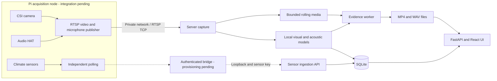

# FALCON architecture

> Design notes collected while FALCON was built (October 2026). Some describe earlier
> states. The current structure is in [ARCHITECTURE.md](../ARCHITECTURE.md).

**Field Acoustic, Lens & Climate Observation Node**

Developer: **Vinay Chittora**. Architecture revision **1.0**, 18 October 2026.
Describes the inspected working source of application version 0.2.0, not a claim
of completed field validation. See [project and code-review guide](PROJECT_GUIDE.md).

## System boundary and implementation status

The Raspberry Pi is the acquisition node; the inference computer is always separate.
The Pi captures camera, microphone and sensor data. The Linux server runs local models,
stores records/evidence and serves the browser interface. Local Ethernet or Wi-Fi
does not require an internet connection once all software, models and taxonomy are cached.

Server RTSP capture, inference, evidence, review, climate history, export, health,
temporary tests and optional boot/remote access are implemented. Pi capture publishing,
audio muxing, physical sensor drivers, a provisioned sensor transport and assembled
hardware acceptance remain pending. The selected rain hardware also needs a new
measurement schema/API/UI/export mapping; schema 1.0 accepts climate fields only.
There is deliberately no Pi recording backlog. Node-to-server link loss creates
coverage gaps; reconnection resumes current capture. Internet loss is a different fault.

## Runtime composition

Production uses one Uvicorn worker on `127.0.0.1:8000`; FastAPI serves the built
React/TypeScript interface and API from one origin. Development adds Vite on port 5173.
`backend/app/main.py` creates shared database, media, sensor, model, job, live,
evidence, temporary-session and appliance services. Within one live inference job,
capture threads, visual inference, the BirdNET CPU subprocess and evidence encoding
can run concurrently. Multiple heavy jobs cannot own the engine simultaneously.
Video decoding and evidence libx264 encoding are CPU work, separate from CUDA models.

## Inference and source adapters

Production React/TypeScript UI → same-origin `/api` → FastAPI on loopback.
The development Vite server uses a same-origin API proxy.
Uploaded originals are served using HTTP byte ranges. File playback remains the master
clock: the canvas and current-events panels query timestamped records, including after
seeks. Live cameras use a separate session receive clock and preview. No annotated video,
continuous raw camera recording or persistent crop is produced. Live encounter evidence
is retained separately as short MP4/WAV clips; see the evidence section below.

File sources decode with PyAV using presentation timestamps; the RTSP source implements
the same frame protocol using capture on a separate thread. Detector, biological classifier
and acoustic analyzer are separate adapters. One worker runs a bounded sampled-frame
pipeline. Generic proposals are deduplicated with optional fixed-camera motion proposals;
original-resolution crops are extracted in memory for the selected BioCLIP model. Before OpenCLIP's square
preprocessing, the complete crop is resized proportionally to at most 512 pixels on its
longest edge and centered on a square gray canvas. This preserves subjects near the crop
edges instead of losing them to a center crop; it does not restore missing image detail.
A tracker aggregates a limited number of sharp crops without asserting biological
identity. It matches boxes by overlap with the last or the motion-predicted box, or by
centre distance of a similar-sized box when a fast bird leaves its previous box behind,
and keeps a lost track alive for about four sampling intervals (at least 2.5 s) so a
brief detector miss does not start a new visit. Every five seconds the accumulated
identity decays to one prior crop that new crops outweigh, so a long visit neither keeps
its first identity forever nor flips to unknown at each window boundary. When the species
stays below threshold, the group (bird, mammal, ...) is still suggested if the top
candidate clears a lower group threshold and the top-five candidates agree on the group.
Each classification carries a certainty tier: likely (a clear species), probable (the best
of the contenders within the ambiguity margin leads the label; the others and their shared
genus, when they have one, are carried as contenders), possible (best match below the
species threshold but above the group threshold, labelled with a question mark) and unknown. The interface colours boxes and cards by that tier and keeps the
numbers in the side panel. A scene-change heuristic resets tracks across large visual changes. Similar-looking
edits can still evade that heuristic. Conservative score/margin/detail rules retain
unknowns. BioCLIP cosine similarity is not a probability.

Visual modes are BioCLIP 2, BioCLIP 2.5 Huge, or both as a cross-check. Each model has a
pinned revision and its own taxonomy/prompt embedding cache. Track evidence is averaged
within each model only. Cross-check mode displays Huge as the primary suggestion and
requires both independently qualified top-one species to match before producing a species
candidate. Otherwise it preserves uncertainty and each model's alternatives. The two
models are related; agreement is not an independent probability estimate. Mode changes
release loaded models. Downloads or inference failures never silently substitute a model.
An explicit GPU load-memory failure may retry the same selection on CPU, recording the
actual device and reduced processing settings. File and live analysis share this logic.

The default detector path uses one full-frame pass. Optional Small wildlife mode adds
overlapping regions, up to five passes per sample, and maps their boxes back through the
ROI to original-image coordinates. Portrait and landscape inputs use three strips that
preserve the full short dimension; squarer images use four grid tiles. This costs more
processing and can increase false proposals as well as recall. Its benefits must be
evaluated on reviewed examples; enabling it does not establish an accuracy gain or a
device throughput claim.

BirdNET runs in a separate Python environment and CPU subprocess, avoiding TensorFlow /
PyTorch dependency and GPU-memory conflicts. Temporary 48 kHz mono audio is removed.
File audio time is mapped to the source presentation timeline. Acoustic detections are
independent evidence of birds heard nearby, never attributed to a visible animal.

iNaturalist place and group IDs are resolved by official APIs. A rate-limited, disk-cached
client retrieves aggregate research-grade species counts with photographs, not observations
or exact coordinates. Scientific names and accepted species IDs form the candidate set.
The expanded cache includes birds and other represented groups, including insect orders.
Species counts are cache-dependent, not fixed architecture limits. The minimum observation count is one; default
per-group caps are 1,000. Group metadata reports scanned, eligible and selected counts,
cap omissions and incomplete scans. Optional canonical species IDs carry explicit-selection
provenance and do not imply regional occurrence. The cache includes provenance and coverage metadata for review.

SQLite retains predictions, review metadata and a transactional review audit. Per-source
JSONL remains a compatibility export;
reanalysis appends a distinct run rather than destroying earlier corrections. File-job
snapshots and progress travel over WebSocket, with REST recovery. Heavy jobs are rejected
while busy. Model instances and taxonomy-keyed text embeddings are reused. Memory and
timing are measured. Current model suggestions still require human review; an expanded
candidate list does not fix missed proposals or calibrate species scores.

File analyses checkpoint complete frames, observations and progress in one SQLite
transaction. Private checkpoint state includes the original effective settings, source
fingerprint, taxonomy version and exact next sampling target. Resume seeks to a preceding
keyframe and preserves the original PTS sampling grid. Displayed coverage is not used
as the seek cutoff. Track identifiers use a fresh segment namespace after resuming;
temporal classifier and motion state restart at that boundary. Legacy partial-frame
observations are reconciled without replacing their IDs or reviews. Audio results commit
as a complete stage, so an interrupted audio stage restarts rather than creating partial
or duplicate acoustic records. Paused workers release the shared inference lease.

Services bind to 127.0.0.1. File paths come only from the sample catalog. The separate live
connection endpoint accepts validated RTSP/RTSPS URLs, not arbitrary file/HTTP URLs.
Local site settings live in ignored configuration; no remote analysis, cloud storage or
precise-location publishing is part of this application.

## People

People are never observations. Person boxes leave the pipeline before classification (unless
non-wildlife logging is on for a test), and the same boxes, padded, are gray-filled in the
review thumbnail, in the preview JPEG until the next analyzed frame, and in every frame of a
saved clip whose window they fall into (a plane fill on the yuv420p array, no colour
conversion). BirdNET is asked for its human-voice classes at a low confidence alongside the
local bird list; those seconds are zeroed in saved WAV evidence and the classes are never
events. The location filter is applied through an explicit species list (built once per
latitude, longitude and week with BirdNET's species tool) so the voice classes can be
requested in that mode too.

## Live camera flow

The user selects **Live camera**, supplies the camera address and separate local RTSP
credentials, chooses whether to analyze camera audio, and starts observing. The app has no
built-in camera IP, credentials or discovery assumption. Connection profiles now persist in local SQLite. Passwords are encrypted using an
owner-only local key, excluded from API responses and events, and resolved only for
the matching saved address/account. The Monitor workspace supports saving and forgetting profiles.
Validation and camera errors avoid echoing connection secrets. Local-origin checks protect
state-changing HTTP requests, and the server stays on loopback.

PyAV opens independent video-only and, when enabled, audio-only RTSP subscriptions to the
same camera using TCP transport. Up to two camera connections are used, so the camera must
permit two simultaneous RTSP sessions when audio is enabled. Disabling audio uses one.
Independent subscriptions keep slow video decoding from starving audio capture. Both
paths retry interrupted connections with bounded backoff; video interruptions clear stale
frames. For cameras that advertise audio but send none after an audio-only request, the
audio connection can fall back to setting up both media tracks while demuxing and decoding
only audio. The two capture connections remain independent. The fallback can increase
network traffic because both tracks may be transmitted, but it does not decode video a
second time. A single latest-frame mailbox replaces old frames while visual inference is busy.
JPEG preview generation is bounded to five frames per second and 1,280 pixels per side;
the browser polls that preview independently of inference. The preview is transient, not
a recording. Current visual events expire based on age and preview alignment.

Audio is resampled to 48 kHz mono PCM and accumulated into nine-second windows. A CPU
worker consumes a one-item queue; a new window replaces an older waiting window if the
worker falls behind. Counters expose dropped windows and analysis latency. BirdNET runs
in its isolated environment, and its process startup is part of the measured cost. Windows
are written only to temporary files and removed after completion, failure or cancellation;
live analysis disables debug-audio retention. Recent audio events use a bounded deque.
The browser shows heard-nearby results after analysis; it does not relay a live audio player.

Video timestamps are session receive times. Audio windows advance by decoded sample count
anchored to receive time. Demuxer PTS jumps greater than 250 ms are diagnostic counters,
not evidence by themselves that audio samples were lost. The partial window and its time
origin reset on a receive gap greater than the larger of two seconds or the current
decoded-frame duration plus 750 ms; a receive-time/sample-coverage deficit greater than
750 ms; an audio format change; or reconnection. Coverage is checked over the current
window rather than accumulating hours of clock drift. This does not verify RTP sequence
continuity or provide synchronized camera capture timestamps. Network buffering and
inference therefore affect visible latency and sensor correlation. A camera without audio
continues with visual analysis and an explicit audio status.

The same process lock and OS file lease exclude concurrent file, live and benchmark
inference. Stop signals capture, visual inference and the CPU audio subprocess; the lease
is retained until workers exit. Detection metadata is appended under a per-session source
ID. In-memory mailboxes are bounded, but event logs do not yet have automatic rotation or
retention, so unattended deployment needs a storage policy. Local RTSP fixture checks are
separate from testing the user's actual camera, network and deployment hardware.

## Photos and climate

Photos use the same proposal/classifier/review pipeline as videos, with one frame at
timestamp zero and no audio stage. The image adapter honors EXIF orientation. Local
multipart uploads stream to a temporary file, validate decoding, then atomically add
the original to the catalog without overwriting another file. Content hashes deduplicate
copies. The UI displays detector confidence separately from species cosine similarity
and BirdNET confidence.

Each visual/audio event has an `environment` object. `SensorHistoryProvider` is
implemented and reads independent SQLite `sensor_readings`. Schema 1.0 accepts
temperature (Celsius), relative humidity (%) and pressure (hPa), stable sensor/reading
IDs, timezone-aware measurement time, quality and an optional note. The server adds
`received_at`; retries are idempotent and conflicting ID reuse returns 409. Unknown
fields/nonfinite values and measurements more than five seconds ahead are rejected.

`POST /api/sensors/readings` requires a local connection and `X-Falcon-Sensor-Key`.
Forwarded/Tailscale-admin requests cannot write readings. A Pi needs a deliberately
provisioned authenticated bridge or SSH forwarding path to this loopback endpoint;
the node installer/transport and physical drivers are not yet built. The web API
must not be opened to the LAN to bypass that boundary.

At a live event the provider selects the latest reading at or before its receive-time
timestamp and retains its age. Default freshness is 120 seconds. Latest suspect or
invalid data remains in history but yields unavailable event context rather than a
silent fallback to older good data. Multiple sensor IDs require an explicit
`SENSOR_ID`; ambiguous associations are not guessed. Event weather is a denormalized
snapshot, not a reading-ID foreign key. Periodic readings persist even without animals.
Uploads lack a trusted wall clock and never inherit current weather.

BME280 and a wet/dry rain plate/controller are selected hardware, not commissioned
drivers. Rain is not in schema 1.0: it needs versioned validation, storage, UI and
export support. Independently poll actual sensors, preserve units/quality and validate
both machine clocks before claiming scientific time alignment. See [sensors](../SENSOR_NODE.md).

## NVIDIA GPU deployment target

The inference computer is always separate from the Raspberry Pi acquisition node.
A Jetson-class inference computer is a possible deployment target, not a tested platform. The setup script
currently provisions Linux x86-64 dependencies; ARM64/JetPack-compatible PyTorch, media
decoding and BirdNET packaging remain deployment work. Desktop CUDA timings cannot be
used as Jetson throughput estimates. TensorRT conversion/quantization is not implemented;
any future optimized model must be checked for output changes as well as speed.

A GPU is not required by the interfaces. With no saved settings, a CPU-only environment
defaults to 0.5 sampled FPS, a 320-pixel detector input and Small wildlife off. Previously
saved settings take precedence. CPU mode uses the same reference models, with bounded
thread counts; the camera's lower-resolution stream can reduce decoding load. Small
wildlife adds up to four detector passes and should be enabled only after measuring its
cost and usefulness on that device.

A compact ONNX classifier/detector can replace the reference adapters later, with model
identity recorded in each event and its predictions separately evaluated. The current
dependency environment still includes CUDA libraries even when inference uses CPU.
The historical desktop CPU smoke test establishes compatibility only; it does not establish
sustained device throughput, power use or detection accuracy.

Only one heavy inference job holds an OS file lease in `data/analysis.lock`, including
benchmark jobs. Process exit releases the lease. The backend and benchmark use separate
job/log folders. Model memory remains cached in the web process between runs. BirdNET is
isolated and its subprocess group is terminated on cancellation. Field deployment still
requires actual camera and sensor tests, sustained-load measurements and a log-retention
policy.

## Local persistence and review interface (October 2026)

SQLite in WAL mode is the authority for jobs, observations, review audit, media metadata
and the saved camera profile. The per-source JSONL mirrors are append-only (a review appends
a superseding line) and are imported incrementally at startup; a torn or malformed line is
skipped with a warning and never stops the application from starting. Legacy files import transactionally and idempotently;
SQLite event IDs prevent duplicate imports. Media remains as original files. JSON/JSONL
compatibility mirrors continue, while API reads use SQLite. Review changes and their
audit entries commit together without changing original model fields.

Monitor, Observations, Media tests, Taxonomy and System are separate workspaces. Archive search filters
and ranks indexed species/source names before pagination. The correction picker uses
ranked common/scientific names and explicit selection, with original media preview.
Standalone sound uploads go directly to BirdNET without initializing visual models.
The visible technical panel shows source metadata and measured live video transport
rates, with missing values distinguished from zero. Raw continuous media is not retained; selected encounter intervals are retained as MP4/WAV evidence.
Source information follows the file-analysis controls and timeline. The Environment
panel is limited to the live camera/device view; uploaded videos, images and sounds do
not show disconnected-device sensor placeholders.

System opens on live input, inference, evidence and sensor health. `/api/system/metrics`
samples CPU, RAM, the data volume and server process with psutil, plus available GPU
telemetry through a two-second-bounded `nvidia-smi` query. A shared five-second cache
serializes probes without starting a CUDA context. The response excludes paths, host
identifiers and raw command errors, and uses the normal API access controls/no-store
policy. WSL CPU/RAM are explicitly distinguished from Windows host totals. Missing
measurements remain null. File-run diagnostics and raw test records stay in Media tests.

Application package initialization opts out of optional inference-library telemetry,
implicit saved Hugging Face token use, update checks, Ultralytics online probes and
automatic package installation before importing those dependencies. Explicit model
downloads and requested taxonomy refreshes remain available; see `SECURITY.md`.

## Live encounter evidence

The RTSP video subscription copies encoded H.264/H.265 packets into a 15-second target
rolling buffer capped at 64 MiB. Sampling pins the relevant GOP and the requested
two-second pre-roll / three-second post-roll before inference. Pending classification
does not keep unrelated future footage. A bounded background worker decodes the selected
interval and encodes H.264 MP4 at the original presentation timing, without model overlays.
Reconnects and timestamp discontinuities create separate capture generations. Storage
checks preserve a 256 MiB free-space reserve; existing saved evidence is never evicted.

Observations inside one five-second capture window can share media. When an animal stays
in view, the next clip starts where the previous clip in the same stream generation ended,
so consecutive clips are contiguous rather than overlapping. These window IDs
are not biological individual counts; an ongoing encounter may span multiple clips.
Partial capture, unavailable keyframes, encoding errors and exhausted resources remain
explicit records. Evidence failure must not prevent observation persistence or model
lease cleanup. Acoustic events retain five-second mono PCM WAV excerpts from the exact
analyzed window, with no padding. Video clips have no audio track; the independent
receive clocks do not establish audiovisual synchronization.

Evidence/session/link tables in SQLite are separate from observation review payloads.
Asynchronous completion cannot overwrite a review. Interrupted pending captures are
recovered only while holding the cross-process inference lease. Source names, saved
analysis settings, server receive-clock anchors and numeric coverage metrics are durable.
The sensor-history provider is implemented; physical node readings remain unavailable
until capture-node drivers and authenticated delivery are commissioned.

The evidence API serves confined local media paths and portable CSV/JSONL/media archives.
See [export format](../DATA_EXPORT.md), [field deployment](field-deployment-design.md) and the
[appliance recovery policy](../INSTALL.md). Physical Pi/sensor integration and full
Camtrap DP validation remain separate implementation work.

## Data model and review integrity

`observations.job_id` is a run identifier: a file job or live evidence session. It
is not a database foreign key to the jobs table. `evidence_links` is the
many-to-many bridge between observations and media with matching source/session
validation. Sensor context is a temporal snapshot, independent of periodic history.

Review states are unreviewed, correct, corrected, unknown and false positive.
The explicit local-taxon selection resolves common/scientific names. Review,
previous/new audit and search-term updates commit together; original predictions
and alternatives remain intact. Corrections do not automatically train models.

## Temporary media-test lifecycle

The browser keeps an ownership ID in tab-local sessionStorage and sends
`X-Falcon-Test-Session`. Heartbeats renew a 24-hour inactivity lease. Explicit End
cancels/waits for owned jobs, then removes owned results and eligible temporary
uploads. Closing a tab does not immediately delete data; periodic expiry cleanup
and restart recovery finish later. Borrowed originals, historical persistent tests,
changed files and shared references are protected. API callers without the header
retain legacy persistent behavior. Ownership IDs are not authentication credentials.
Pause/resume applies while the session is active; ending it discards paused work.

## Browser, health and network policy

Live preview polls JPEGs approximately every 500 ms and state every second; it is
not full-frame-rate browser video. File jobs use WebSockets plus 1.5-second polling.
System health polls independent input/sensor/host endpoints in bounded rounds near
five seconds. Null and stale measurements are distinguished from zero. The PWA
service worker caches only an offline help page; it does not run inference offline
or cache observations, API responses or media. The backend must remain available.

Optional remote access is approved Tailscale client -> Tailscale Serve HTTPS ->
loopback FALCON. Exact hostname and login allowlist checks apply. Remote uploads
and remote access-policy changes are rejected. All approved admins have control;
there are no read-only roles. SSH is separately provisioned OS access, not an app
shell. Local users/programs are trusted; origin checks do not authenticate them.

Inference media stays on the server. Model downloads, requested taxonomy refresh,
dependency installation and an explicit Tailscale connectivity check can contact
external services. Tailscale has separate coordination/relay traffic. Telemetry
settings are not an egress firewall or an audit of the whole PC/camera/router.
See `SECURITY.md` and [remote access](../REMOTE_ACCESS.md).

## Export, retention and validation limits

Field UI queries `scope=live`; compatibility APIs can default to all sources.
Portable ZIP exports include observations CSV/JSONL, review audit, evidence tables,
sessions, sensor CSV/JSONL, manifest, guide and media with stable IDs and SHA256.
The unfiltered field export includes independent periodic sensor history. A source
filter needs an explicit recorded sensor binding and trustworthy session bounds.
Missing bindings/media and changed files are reported, not silently repaired.
Accepted human names remain separate from model guesses; CSV formula-like text is
escaped and JSONL retains precision. Session settings omit connection credentials.

Observation/review/sensor tables share a database read snapshot; evidence/media
inventory is collected earlier, so the entire live archive is not one atomic instant.
It is FALCON portable archive 1.0, not a validated Camtrap DP export. No data or media
license is assigned automatically. Field data and logs have no automatic retention
policy. Use SQLite-consistent backups plus required media/settings/key files;
a source release is not a field-data backup. See [data export](../DATA_EXPORT.md).

The installer targets Linux x86-64. Optional systemd user service and opt-in
auto-observe are implemented; boot without login requires lingering, mounted storage
and device power recovery. Service restart is not a native/GPU-hang watchdog.
Manual Stop overrides automatic observation for that backend lifetime. See
[appliance](../INSTALL.md) for exact retries and service operation.

Automated tests exercise software behavior, not field accuracy, Pi capacity or
weather resistance. Pending work includes Pi camera/audio provisioning, physical
sensor drivers/bridge, rain schema, synchronized clocks, power/storage acceptance,
accuracy evaluation and validated standards export. Multi-camera scheduling,
automatic model training and synchronized audiovisual evidence are not implemented.
